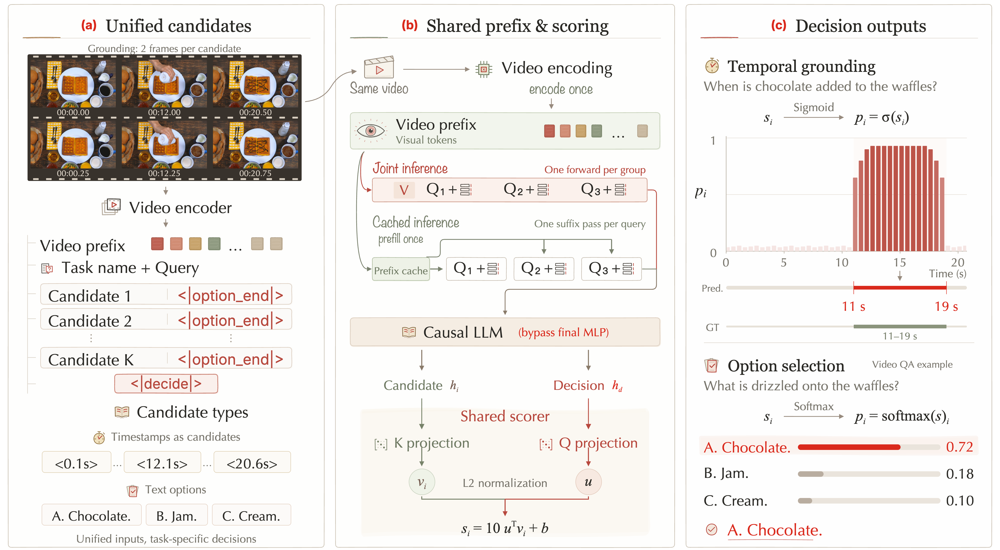
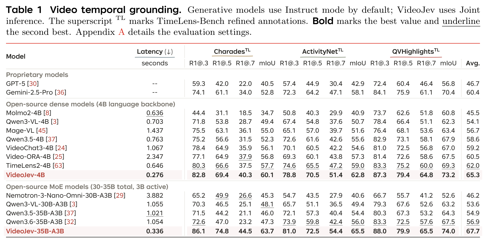
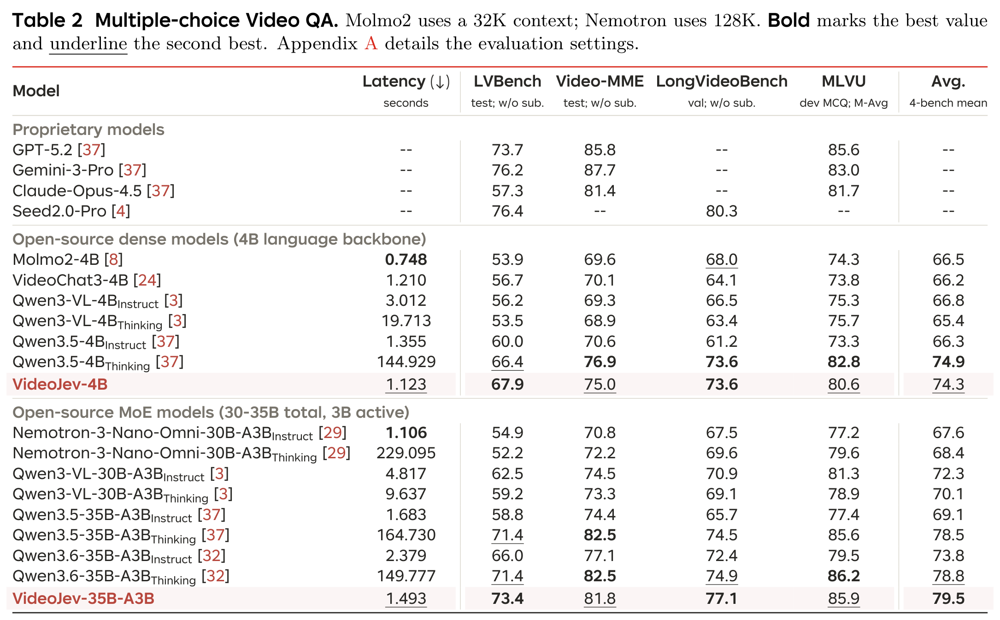

<p align="center">
  <picture>
    <source media="(prefers-color-scheme: dark)" srcset="docs/assets/readme-header-dark.svg">
    <source media="(prefers-color-scheme: light)" srcset="docs/assets/readme-header.svg">
    
  </picture>
</p>

<h3 align="center">System One Model for Video Understanding and Interaction</h3>

<p align="center">
  <a href="https://mcg-nju.github.io/VideoJev"></a>
  <a href="docs/PAPER.md"></a>
  <a href="https://huggingface.co/MCG-NJU/VideoJev-4B"></a>
  <a href="https://huggingface.co/MCG-NJU/VideoJev-35B-A3B"></a>
</p>

<p align="center">
  <a href="#overview">Overview</a> ·
  <a href="#results">Results</a> ·
  <a href="#models">Models</a> ·
  <a href="#quick-start">Quick start</a> ·
  <a href="#inference-output">Outputs</a> ·
  <a href="#training">Training</a> ·
  <a href="#evaluation">Evaluation</a>
</p>

<p align="center">
  <strong>Direct decisions. Shared computation.</strong><br>
  Ground moments and select answers through a unified candidate-scoring interface.
</p>

<p align="center">
  
  <br><sub>One decision interface for temporal grounding and video QA. Paper-reported quality and forward latency at both model scales.</sub>
</p>

---

## Overview

**VideoJev is a family of video System One models** that combines pretrained multimodal understanding with efficient direct prediction. Temporal grounding and multiple-choice video QA share a candidate scorer that evaluates video evidence without autoregressive answer decoding. These structured judgments provide building blocks for video understanding and interaction.

| Task | Candidates | Decision |
|---|---|---|
| **Temporal grounding** | Native two-frame temporal intervals, represented by timestamps | Score event membership and decode a start/end interval. |
| **Video QA** | Supplied textual answer options | Score the options and select the best-supported answer. |

The paper studies **Cached inference** for arriving queries and **Joint inference** for questions available together. The released inference API uses Joint query grouping: one complete video prefix followed by multiple questions, with one causal forward per group and no reference or predicted answers appended. See [paper details](docs/PAPER.md) for authors, architecture, inference modes, and the measurement protocol.

<details>
<summary><strong>Method at a glance</strong></summary>



The model retains native causal attention and DeltaNet, removes the last decoder MLP, and uses a shared 512-dimensional normalized Q/K head with cosine scale 10 and a learned bias. Grounding applies sigmoid membership scores; QA applies softmax over options. Vision and the visual connector remain frozen during training.

When a video and its questions exceed context, grouping splits only between complete questions. Each new group repeats the complete video prefix and starts fresh attention/DeltaNet state. No question is truncated or silently skipped. The method figure's scores and example interval are illustrative.

</details>

## Results

Main results from the manuscript, using **Joint inference**. Grounding uses TimeLens-Bench refined annotations; QA uses video frames without subtitles or audio.

### Temporal grounding



VideoJev improves mean mIoU over its respective Instruct backbone by **6.7 / 10.8 points**, with **2.8× / 3.1×** measured forward-time speedups.

### Video question answering



Both models achieve mean QA performance comparable to their Thinking backbones, with **129× / 100×** measured forward-time speedups. QA reports accuracy, except MLVU's seven-task M-Avg.

Latency is measured on H200 at batch size 1 over full Charades (grounding) and full LVBench (QA). It includes visual encoding and model forward computation, with shared video prefixes for generative baselines too; preprocessing and data transfers are excluded. These are paper-reported results. The manuscript settings and differences from current release defaults are documented in [Paper details](docs/PAPER.md#reported-results-and-measurement-protocol).

## Models

| Model | Base model | Weight format | Usage |
|---|---|---|---|
| **VideoJev-4B** | [Qwen3.5-4B](https://huggingface.co/Qwen/Qwen3.5-4B) | BF16 · Safetensors | [Model & examples ↗](https://huggingface.co/MCG-NJU/VideoJev-4B) |
| **VideoJev-35B-A3B** | [Qwen3.6-35B-A3B](https://huggingface.co/Qwen/Qwen3.6-35B-A3B) | BF16 · Safetensors | [Model & examples ↗](https://huggingface.co/MCG-NJU/VideoJev-35B-A3B) |

## Quick start

Set up the [environment](#environment), then run this example.

Run grounding and QA on [Eating spaghetti](https://huggingface.co/datasets/ZhuYuhan/VideoJev-Demo/resolve/7e2b9685bca592c3b929268f6fcf82c4ad74b267/eating_spaghetti.mp4) (10 seconds), at 2 FPS.

```python
import json
import torch
from huggingface_hub import hf_hub_download
from transformers import AutoModel, AutoProcessor

video = hf_hub_download(
    repo_id="ZhuYuhan/VideoJev-Demo", filename="eating_spaghetti.mp4",
    repo_type="dataset", revision="7e2b9685bca592c3b929268f6fcf82c4ad74b267",
)
repo = "MCG-NJU/VideoJev-4B"
processor = AutoProcessor.from_pretrained(repo, trust_remote_code=True)
model = AutoModel.from_pretrained(
    repo, trust_remote_code=True, dtype=torch.bfloat16,
    device_map={"": "cuda:0"}, attn_implementation="flash_attention_2",
)
model.prepare_for_inference()

questions = [
    {"id": "grounding-1", "task": "grounding",
     "query": "The woman in green eats pasta."},
    {"id": "qa-1", "task": "choice",
     "query": "What is the woman in green eating?",
     "options": ["A. Pasta.", "B. Rice.", "C. Soup."]},
]
results = model.predict_video(
    processor, video, questions,
    fps=2.0, max_frames=2048, context=8192,
)
print(json.dumps(results, indent=2))
```

Use `MCG-NJU/VideoJev-35B-A3B` to load the larger model. See the [evaluation guide](docs/EVALUATION.md) for benchmark settings.

## Inference output

Actual output from the video and code above:

```json
[
  {
    "id": "grounding-1",
    "task": "grounding",
    "probabilities": [
      0.005761092994362116,
      0.010865824297070503,
      0.026081746444106102,
      0.9046059250831604,
      0.9879851937294006,
      0.9887627959251404,
      0.9896195530891418,
      0.9849089980125427,
      0.833530068397522,
      0.33037981390953064
    ],
    "interval": [
      3.0,
      10.0
    ]
  },
  {
    "id": "qa-1",
    "task": "choice",
    "probabilities": [
      0.9999161958694458,
      5.755242091254331e-05,
      2.617507561808452e-05
    ],
    "answer_index": 0,
    "answer": "A. Pasta."
  }
]
```

`interval` is in seconds; `answer_index` is zero-based. `probabilities` contains independent sigmoid scores for grounding and softmax scores over QA options.

Grounding defaults to `threshold=0.25`; pass `threshold=0.4` to `predict_video` or `predict_features` to override it for one call.

## Environment

Use Python 3.12, PyTorch 2.8 with CUDA 12.8, Triton 3.4, FlashAttention 2 and causal-conv1d. Install the matching CUDA packages before the Python dependencies:

```bash
pip install -r requirements.txt
source scripts/env.sh
```

<details>
<summary><strong>Training dependencies and base-model paths</strong></summary>

Training also requires [XTuner](https://github.com/InternLM/xtuner), including its compiled grouped-GEMM/token-permutation CUDA extension for the 35B MoE model. The source environment used revision `76e705134521eff867b409f3b3451df1c4d8dd36`. Set `XTUNER_ROOT` to your checkout before sourcing `scripts/env.sh`, or install XTuner into the active environment. The launchers use the active Python interpreter; they do not depend on a shared Conda installation.

Place the original Qwen model directories under `models/Qwen3.5-4B` and `models/Qwen3.6-35B-A3B`, or set `VIDEOJEV_BASE_4B` and `VIDEOJEV_BASE_35B` to local model directories. These must include the tokenizer, processor, configuration and weights.

</details>

## Data

Prepare the manifests, video/frame sources and feature/packing metadata described in [docs/DATA.md](docs/DATA.md). The code release does not bundle datasets, checkpoints, feature caches or historical outputs. Configuration paths beginning with `data/`, `models/` or `configs/` resolve relative to this repository; explicit absolute paths are supported.

RGB planning entrypoints are `scripts/prepare_rgb192.py`, `scripts/prepare_qwen36_mixed.py` and `scripts/prepare_context_eval.py`. They require the prepared source manifests and video split. Run them with `--help` for arguments. Changing media paths, tokenizer, context or input code requires regenerating the corresponding metadata and hashes.

## Training

### Recipe

| Stage | Trainable parameters | Grounding loss | QA loss |
|---|---|---|---|
| **Head warmup** | Shared head | BCE | CE |
| **Joint** | Language backbone + head | BCE + 2 × duration-weighted SoftIoU | CE |

Vision and the visual connector remain frozen. There is no hard-negative objective for either task.

<details>
<summary><strong>Optimization settings</strong></summary>

Both stages use one epoch, independent optimizers, 5% warmup, and cosine decay to 10% of peak LR. Global batch size is 64 complete packs.

| Parameter | 4B | 35B-A3B |
|---|---|---|
| Head peak LR · warmup / joint | 3e-4 / 1e-4 | 3e-4 / 1e-4 |
| Joint language-backbone LR | 5e-6 | 2e-6 |

</details>

### Launch

Launch once on each of **8 nodes × 8 GPUs**. All nodes must share the same model/data/output paths. Set `NODE_RANK` to 0–7 and use the same reachable `MASTER_ADDR`, `MASTER_PORT`, and absolute `WORK_DIR` on all nodes:

```bash
source scripts/env.sh
NODE_RANK=0 MASTER_ADDR=192.0.2.10 WORK_DIR="$PWD/runs/videojev4b" \
  bash scripts/train_eval_8nodes.sh --dry-run
```

Remove `--dry-run` to train both stages and evaluate. Run the corresponding data planner first.

| Recipe | Launcher | Tokens / pack |
|---|---|---:|
| 4B · features | `scripts/train_eval_8nodes.sh` | 147456 |
| 4B · RGB | `scripts/train_eval_rgb192_8nodes.sh` | 196608 |
| 35B-A3B | `scripts/train_eval_qwen36_8nodes.sh` | 147456 |

For 35B, source `scripts/env_qwen36.sh` before launching.

### Checkpoints

The **4B joint stage exports a Hugging Face model directory by default**:

```text
joint/hf_checkpoint/
├── config.json
├── model-*.safetensors
├── model.safetensors.index.json
└── … tokenizer, processor, and inference code
```

Floating-point weights preserve the input model's precision: BF16 for Qwen3.5-4B. DeepSpeed recovery state stays separate; the warmup handoff uses `head.pt`. See [Checkpoint export](docs/CHECKPOINTS.md) for earlier `.pt` checkpoints and standalone 35B conversion.

<details>
<summary><strong>Resume and export behavior</strong></summary>

The launchers retain source/configuration snapshots, resume complete checkpoints, and validate completion before cleanup. Use a new `WORK_DIR` for a changed recipe. Existing weights are not retrained by copying this repository.

The HF exporter follows XTuner's separation of resumable training state and inference exports, explicit weight casting, native key layout, safetensors shards/index, and tokenizer saving. `scripts/export_hf.py` converts earlier task checkpoints. `AutoModel.from_pretrained(..., trust_remote_code=True)` loads the bundled VideoJev inference class with the native Qwen backbone and trained decision head.

</details>

## Evaluation

**Complete video. Ordered questions. Fresh state between groups.** All entrypoints use same-video, manifest-order query groups. If the context limit is reached, greedy grouping splits only between questions and repeats the complete video prefix. No question is truncated or silently skipped. See the [evaluation protocol](docs/EVALUATION.md).

```bash
source scripts/env.sh

# Seven benchmarks at the feature recipe's checkpoint configuration.
python scripts/evaluate.py \
  --checkpoint /path/to/joint/hf_checkpoint --out runs/eval4b

# QA at both long contexts, using prepared offline vision features.
python scripts/evaluate_cached_contexts.py \
  --checkpoint /path/to/joint/hf_checkpoint \
  --plans /path/to/context_plans --feature-cache /path/to/qa_features \
  --out runs/eval4b_qa
```

<details>
<summary><strong>Distributed evaluation and complete plan bundles</strong></summary>

Use `torchrun` for distributed evaluation. `scripts/evaluate_4b_multiturn.py` evaluates an input-only plan covering all eleven benchmark/context combinations; `scripts/prepare_multiturn_eval.py` freezes such a supplied plan bundle.

The 35B distributed evaluator uses the 64-GPU training topology:

```bash
# Invoke through the distributed launcher on the allocated nodes.
python scripts/evaluate_qwen36.py \
  --checkpoint /path/to/export \
  --plans /path/to/plans \
  --out /path/to/evaluation
```

</details>

Outputs include prediction files, metrics, input/model identities, and completion hashes. Completed outputs are reused only when identities match. Both model sizes default to grounding threshold 0.25 with round/repair/clamp postprocessing. Override it with `threshold=...` in the HF inference API or `decoder_thresholds` in an evaluation config. The paper uses a fixed 262144-token QA context; see [release defaults versus paper settings](docs/PAPER.md#current-release-defaults) before reproducing its tables.

## Verification

```bash
source scripts/env.sh
python -m pytest -q tests
# Optional tokenizer-based checks, without loading model weights:
VIDEOJEV_TEST_MODEL=/path/to/Qwen3.5-4B python -m pytest -q tests
```

Tests requiring full benchmark annotations, prepared plans, or local tokenizers skip when those inputs are absent. Unit tests cover task losses and gradients, packing/tail handling, temporal decoding, multi-query inputs, feature reuse, and snapshot/resume contracts. Distributed GPU training and full benchmark runs require separately provisioned resources and data.

## Documentation

| Guide | What's inside |
|---|---|
| [Paper details](docs/PAPER.md) | Authors, method, inference modes, reported results, and measurement protocol. |
| [Data preparation](docs/DATA.md) | Manifests, media sources, feature metadata, and packing plans. |
| [Evaluation protocol](docs/EVALUATION.md) | Benchmarks, context settings, temporal decoding, and coverage checks. |
| [Checkpoint export](docs/CHECKPOINTS.md) | HF conversion, source identity, precision, and training recovery. |
| [4B model card](https://huggingface.co/MCG-NJU/VideoJev-4B) · [35B-A3B model card](https://huggingface.co/MCG-NJU/VideoJev-35B-A3B) | Installation, inference, visual feature reuse, and model-specific outputs. |

---

Built on [Qwen](https://huggingface.co/Qwen) and [XTuner](https://github.com/InternLM/xtuner). Released under [Apache 2.0](LICENSE); see [NOTICE](NOTICE) for attribution.
