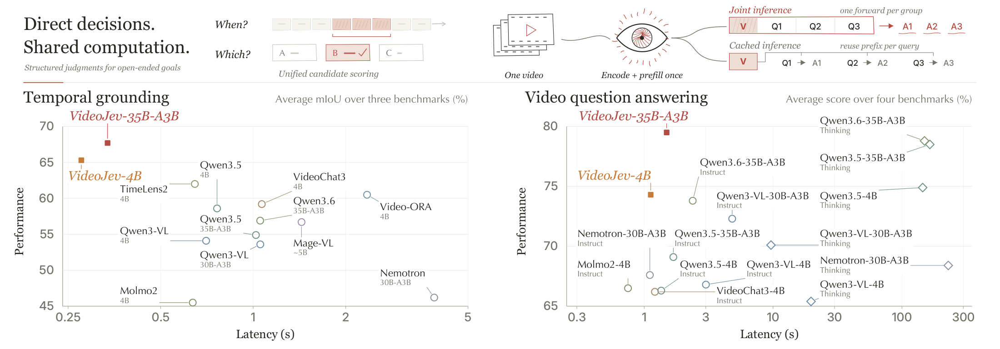
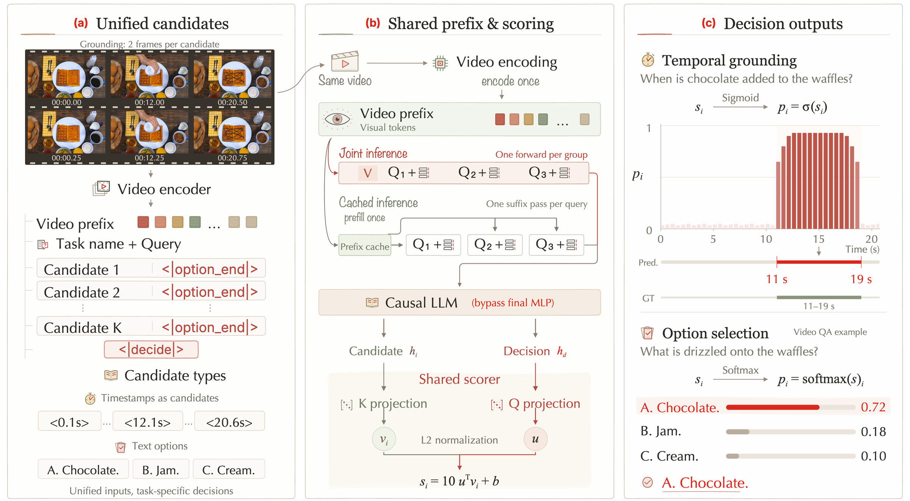

<h1 align="center">VideoJev</h1>
<h3 align="center">System One Model for Video Understanding and Interaction</h3>

<p align="center">
  Yuhan Zhu<sup>1,*</sup>, Xiangyu Zeng<sup>1,*</sup>, Qingyi Si<sup>2,*,‡</sup>, Chenxu Yang<sup>3,*</sup>, Yifei Li<sup>4,*</sup>, Junhao Zhou<sup>3</sup><br>
  Dingyu Yao<sup>3</sup>, Jun Zhang<sup>2</sup>, Chuanyu Qin<sup>3</sup>, Luozheng Qin<sup>5</sup>, Zhiqiu Zhang<sup>6</sup>, Yuandong Yang<sup>1</sup><br>
  Yuqi Xu<sup>2</sup>, Tianyu Zhang<sup>7</sup>, Hongcheng Guo<sup>8</sup>, Jiaqi Wang<sup>2</sup>, Nan Duan<sup>2</sup>, Limin Wang<sup>1,†</sup>
</p>

<p align="center">
  <sup>1</sup>NJU · <sup>2</sup>JD.com · <sup>3</sup>UCAS · <sup>4</sup>THU<br>
  <sup>5</sup>XMU · <sup>6</sup>SJTU · <sup>7</sup>USTC · <sup>8</sup>FDU<br>
  <sub>* Equal contribution. ‡ Project lead. † Corresponding author.</sub>
</p>

<!-- TODO(release-links): Replace the status anchors with verified public URLs when available. -->
<p align="center">
  <a href="#release-status">
    
  </a>
  <a href="#release-status">
    
  </a>
  <a href="#models-and-data">
    
  </a>
</p>

<p align="center">
  <a href="#overview">Overview</a> ·
  <a href="#method">Method</a> ·
  <a href="#models-and-data">Models and data</a> ·
  <a href="#results">Results</a> ·
  <a href="#quick-start">Quick start</a> ·
  <a href="#citation">Citation</a>
</p>

<p align="center"><strong>Direct decisions. Shared computation.</strong></p>

## Updates

- **2026/10/10**: The VideoJev repository is initialized with the project overview, method figures, and results. Code and model release updates will be posted here.

## Release status

This repository currently provides the project overview and paper figures. Runnable code, checkpoints, and installation instructions will be added in future updates.

- [x] Project overview and main results
- [x] Method and overview figures
- [ ] Public paper link and final citation
- [ ] Model checkpoints
- [ ] Inference code and examples
- [ ] Evaluation code and data preparation guides
- [ ] Training code and configurations

## Overview

**VideoJev** is a family of video **System One** models that combines pretrained multimodal understanding with efficient direct prediction. It unifies **video temporal grounding** and **multiple-choice video question answering** through a shared candidate-scoring interface, evaluating temporal intervals and textual options against video evidence without autoregressive answer decoding.

VideoJev reuses visual computation across repeated judgments. **Cached inference** reuses a video prefix for arriving queries, while **Joint inference** scores multiple queries in a single forward pass per query group.

<p align="center">
  
  <br><sub>Prediction quality versus amortized model forward latency. Grounding scores average three benchmarks; video QA scores average four benchmarks. Latency is measured on Charades and LVBench, respectively.</sub>
</p>

- **One interface, two tasks:** The same scorer handles temporal intervals and answer options.
- **Reusable video computation:** Encode the video once and share its prefix across queries.
- **Strong temporal grounding:** VideoJev-4B and VideoJev-35B-A3B improve mean mIoU over their backbones by **6.7** and **10.8** points, with measured **2.8–3.1×** inference speedups.
- **Efficient video QA:** Both models achieve performance comparable to their Thinking-mode backbones, with measured speedups of approximately **129×** and **100×** on LVBench.

## Method

<p align="center">
  
  <br><sub>Temporal intervals and textual options share an input format and scoring head. The output rule converts scores into a temporal span or an answer choice.</sub>
</p>

**Unified candidate scoring.** VideoJev adapts a pretrained video-language model by removing the final MLP and replacing the language-model output head with a candidate scorer. Each candidate ends with `<|option_end|>`, and a `<|decide|>` token provides the query-level decision readout. Projected candidate and decision features produce similarity scores through a shared head.

**Task-specific decisions.** Temporal grounding applies sigmoid scores to candidate intervals and decodes a contiguous event span. Multiple-choice video QA applies softmax over textual options and selects the highest-scoring answer.

**Shared computation.** Cached inference processes each query suffix against the same cached video prefix. Joint inference places multiple queries after one video prefix and reads out all their scores in one causal forward pass per group. Neither mode requires autoregressive answer decoding.

## Models and data

<!-- TODO(models): Add checkpoint links and model cards after verifying access and the released configurations. -->
| Model | Backbone | Supported tasks | Checkpoint |
| :--- | :--- | :--- | :--- |
| **VideoJev-4B** | Qwen3.5-4B | Temporal grounding and multiple-choice video QA | Coming soon |
| **VideoJev-35B-A3B** | Qwen3.6-35B-A3B | Temporal grounding and multiple-choice video QA | Coming soon |

Training combines **TimeLens-100K** and **TimeLens2-93K** for temporal grounding with an internally curated corpus of approximately **240K multiple-choice questions over 19K videos**. Data preparation instructions and information about releasable resources will be added with the training code.

## Results

Selected results from Tables 1 and 2 of the paper are shown below. VideoJev uses **Joint inference**. Scores are percentages, and higher is better; latency is amortized model forward time in seconds per query, and lower is better.

### Video temporal grounding

Results use the **TimeLens-Bench refined annotations** of Charades-STA, ActivityNet Captions, and QVHighlights. The table reports mIoU and its three-benchmark mean. Generative baselines use Instruct mode.

| Model | Charades<sup>TL</sup> | ActivityNet<sup>TL</sup> | QVHighlights<sup>TL</sup> | Avg. mIoU | Latency (s) ↓ |
| :--- | ---: | ---: | ---: | ---: | ---: |
| Qwen3.5-4B | 52.3 | 55.6 | 67.9 | 58.6 | 0.763 |
| TimeLens2-4B | 57.7 | 59.0 | 69.3 | 62.0 | 0.646 |
| **VideoJev-4B** | **60.1** | **62.8** | **73.2** | **65.3** | **0.276** |
| Qwen3.6-35B-A3B | 47.3 | 56.0 | 67.5 | 56.9 | 1.054 |
| **VideoJev-35B-A3B** | **63.7** | **65.5** | **74.0** | **67.7** | **0.336** |

### Multiple-choice video QA

Evaluation uses video frames without subtitles or audio. LVBench, Video-MME, and LongVideoBench report accuracy; MLVU reports M-Avg. Boldface highlights VideoJev rows.

| Model | LVBench | Video-MME | LongVideoBench | MLVU | Avg. | Latency (s) ↓ |
| :--- | ---: | ---: | ---: | ---: | ---: | ---: |
| Qwen3.5-4B Instruct | 60.0 | 70.6 | 61.2 | 73.3 | 66.3 | 1.355 |
| Qwen3.5-4B Thinking | 66.4 | 76.9 | 73.6 | 82.8 | 74.9 | 144.929 |
| **VideoJev-4B** | **67.9** | **75.0** | **73.6** | **80.6** | **74.3** | **1.123** |
| Qwen3.6-35B-A3B Instruct | 66.0 | 77.1 | 72.4 | 79.5 | 73.8 | 2.379 |
| Qwen3.6-35B-A3B Thinking | 71.4 | 82.5 | 74.9 | 86.2 | 78.8 | 149.777 |
| **VideoJev-35B-A3B** | **73.4** | **81.8** | **77.1** | **85.9** | **79.5** | **1.493** |

<details>
<summary><strong>Evaluation and latency notes</strong></summary>

- Grounding latency is measured on the full Charades test set: **1,313 videos / 3,363 queries**.
- QA latency is measured on the full LVBench test set: **103 videos / 1,549 questions**.
- Measurements use **NVIDIA H200 GPUs, batch size 1**, and include visual encoding, prefix prefill, and model forward computation. Preprocessing and data transfers are excluded.
- VideoJev shares video computation through Joint inference. Generative baselines share visual encoding and prefix prefill, then decode answers from independent query branches.
- VideoJev QA uses a fixed **256K-token context budget**. Benchmark splits are LVBench test, Video-MME test, LongVideoBench validation, and MLVU development multiple-choice tasks.
- Full protocols, benchmark preparation, and reproduction commands will accompany the evaluation code.

</details>

## Codebase

The code layout below is planned and will be finalized with the release. Only `assets/` and `docs/` are present in this initial version.

<!-- TODO(codebase): Replace planned paths with the actual directories and link their guides and entry points. -->
| Directory | Purpose | Status |
| :--- | :--- | :--- |
| [`assets/`](assets/README.md) | Figures displayed in this README | Available |
| [`docs/`](docs/RELEASE_CHECKLIST.md) | Documentation and release checklist | Available |
| `Inference/` | Temporal grounding and video QA examples | Planned |
| `Eval/` | Benchmark preparation, inference, and scoring | Planned |
| `Train/` | Training recipes and model configurations | Planned |

## Quick start

### Get the repository

```bash
git clone git@github.com:MCG-NJU/VideoJev.git
cd VideoJev
```

### Installation

Coming soon. Supported Python, PyTorch, CUDA, and model-library versions, together with tested installation commands, will be documented here when the code is released.

<!-- TODO(installation): Add a tested environment setup, dependency file, supported hardware, and checkpoint download instructions. -->

### Inference

Coming soon. Examples will cover temporal grounding and multiple-choice video QA, including Cached inference and Joint inference.

<!-- TODO(inference): Add runnable examples with real script paths, input formats, checkpoint arguments, and expected outputs. -->

### Evaluation

Coming soon. Dataset preparation, benchmark configuration, prediction, and scoring instructions will be added for the three grounding and four video QA benchmarks above.

<!-- TODO(evaluation): Link the released evaluation guide and include tested commands matching the reported protocols. -->

### Training

Coming soon. The training guide will describe scorer alignment followed by joint adaptation of the language backbone and scoring head.

<!-- TODO(training): Add data preparation, two-stage configurations, launch commands, and compute requirements. -->

## License and acknowledgements

License information will be added with the code release. Model checkpoints and third-party datasets remain subject to their respective terms.

We thank the authors of Qwen, TimeLens, TimeLens2, and the benchmark resources used in this work. README figures come from the VideoJev paper; see [figure sources](assets/README.md).

<!-- TODO(license): Add the selected LICENSE and any required third-party notices before publishing code. -->

## Citation

The entry below is a preliminary repository citation. The canonical paper link and publication metadata will be added after release.

<!-- TODO(citation): Replace this entry with the final paper BibTeX; do not guess an arXiv identifier or venue. -->
```bibtex
@misc{zhu2026videojev,
  title={VideoJev: System One Model for Video Understanding and Interaction},
  author={Yuhan Zhu and Xiangyu Zeng and Qingyi Si and Chenxu Yang and Yifei Li and Junhao Zhou and Dingyu Yao and Jun Zhang and Chuanyu Qin and Luozheng Qin and Zhiqiu Zhang and Yuandong Yang and Yuqi Xu and Tianyu Zhang and Hongcheng Guo and Jiaqi Wang and Nan Duan and Limin Wang},
  year={2026},
  url={https://github.com/MCG-NJU/VideoJev}
}
```
